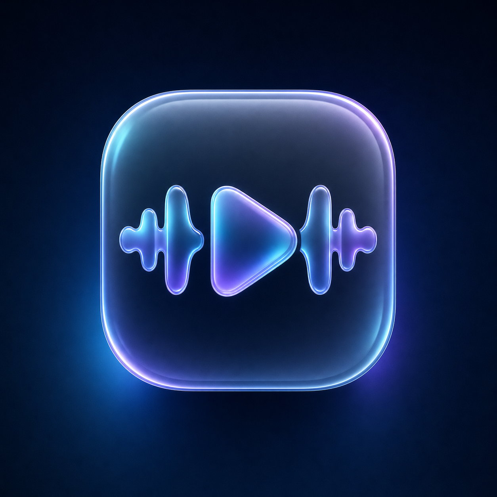

<div align="center">



# Zuiwan

[](https://github.com/truecurrentz/Zuiwan-musicdeplaya/actions/workflows/build.yml)
[](LICENSE)

[**Download**](#download) | [**Features**](#features) | [**Build**](#build) | [**License**](#license)

</div>

> [!NOTE]
> If YouTube Music is unavailable in your region, connect through a supported region or change the content region in **Settings**.

---

## Features

<table>
  <tr>
    <td width="50%" valign="top">

#### Playback & Local Music
- Stream songs, albums, playlists & music videos or play local MP3, FLAC, WAV, M4A, OGG & OPUS files
- Device audio scanner, folder organization & SAF file importer
- Offline downloads & smart stream caching
- Built-in metadata/cover art editor, cue trimmer & `.m4a` clip exporter
- Skip silence, sleep timer & persistent queue restoration

</td>
    <td width="50%" valign="top">

#### Audio Effects & DSP
- Real-time Bass Boost, Stereo Widener, Studio Reverb, 8D Orbit, Channel Balance & Night Limiter
- Real-time 10-band parametric biquad equalizer & preamp
- Loudness normalization (-14 LUFS ReplayGain)
- Independent tempo & pitch control
- Smooth crossfade ramp

</td>
  </tr>
  <tr>
    <td width="50%" valign="top">

#### Visualizer, Lyrics & Discovery
- GPU **WebGL Shader Effects** (`Aurora`, `Nebula`, `Rings`, `Grid`, `Liquid`) & live 512-point FFT spectrum visualizers
- **Syllable-Synced Lyrics** with progressive glow & CJK/Cyrillic romanization
- Dedicated **Fullscreen Visualizer** stage plus custom Player banner & background
- Built-in **Recognize Music** acoustic fingerprinting (`currents`) with recognition history

</td>
    <td width="50%" valign="top">

#### Studio Customization & Sync
- **Dark** & **White** borderless Frosted Glass UI with live blur & opacity controls
- **Zuiwan Studio**: custom accent colors, custom wallpapers, animated GIF / looping video backgrounds, custom `.ttf`/`.otf` fonts, **Custom CSS** engine, **Plugins**, and Compact / Fullscreen modes
- Full **YouTube Music Sync** & universal **Playlist Import / Export** (`.csv`, `.m3u`/`.m3u8`, `.json`, `.pls`, `.xspf`, `.txt`, links) + `.zip` backup/restore
- Android phone **Update Notifications** with changelog viewer & seamless signed APK updates

</td>
  </tr>
</table>

---

## Download

Grab the latest `Zuiwan.apk` from [**Releases**](https://github.com/truecurrentz/Zuiwan-musicdeplaya/releases) or [**GitHub Actions Artifacts**](https://github.com/truecurrentz/Zuiwan-musicdeplaya/actions).

---

## Build

Requires **JDK 21** and the **Android SDK (API 36/37)**.

```bash
git clone https://github.com/truecurrentz/Zuiwan-musicdeplaya.git
cd Zuiwan-musicdeplaya
./gradlew assembleRelease
```

---

## License

Zuiwan is licensed under the [**GPL-3.0 License**](LICENSE).
