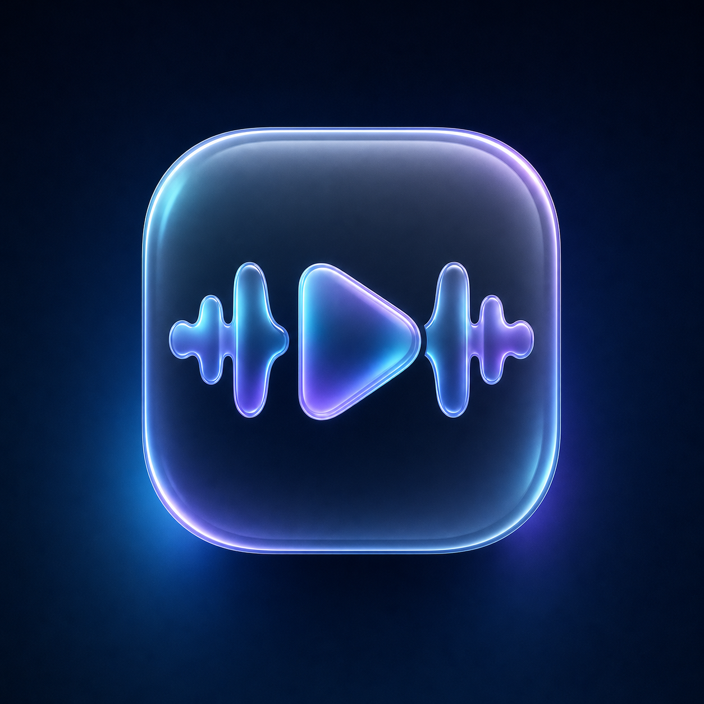

<div align="center">



# Zuiwan

### Frosted Glass YouTube Music client for Android

[](https://github.com/truecurrentz/Zuiwan/actions/workflows/build.yml)
[](LICENSE)

[**Download**](#download) | [**Features**](#features) | [**Build**](#build) | [**License**](#license)

</div>

> [!NOTE]
> If YouTube Music is unavailable in your region, connect through a supported region or change the content region in **Settings**.

---

## Features

<table>
  <tr>
    <td width="50%" valign="top">

#### Playback
- Stream songs, albums, playlists & music videos from YouTube Music
- Gapless background playback with Media3 session controls
- Offline downloads & smart stream caching
- Skip silence & persistent queue restoration
- Sleep timer with end-of-track stop

</td>
    <td width="50%" valign="top">

#### Audio & DSP
- Loudness normalization (-14 LUFS ReplayGain)
- Real-time 10-band parametric biquad equalizer & preamp
- Live frequency-response curve & studio presets
- Independent tempo & pitch control
- Smooth crossfade ramp

</td>
  </tr>
  <tr>
    <td width="50%" valign="top">

#### Lyrics & Discovery
- Word-by-word & line-synced live lyrics (BetterLyrics, LrcLib, KuGou, YouTube Music)
- Automatic CJK & Cyrillic romanization
- Synced & plain lyric modes with tap-to-seek
- Quick Picks, Keep Listening, Explore, Unique Songs, Moods & Charts

</td>
    <td width="50%" valign="top">

#### Frosted Glass UI & Library
- iOS-inspired Frosted Glass interface with **Dark** and **White** themes
- Real-time GPU backdrop blur on connected floating bars and immersive full-bleed player
- Pure geometric vector icon suite across every screen and sheet
- Local playlists, `.m3u` import/export, YouTube Music cloud sync & `.zip` backup/restore

</td>
  </tr>
</table>

---

## Download

Grab the latest `Zuiwan.apk` from [**GitHub Actions Artifacts**](https://github.com/truecurrentz/Zuiwan/actions) or [**Releases**](https://github.com/truecurrentz/Zuiwan/releases).

---

## Build

Requires **JDK 21** and the **Android SDK (API 36/37)**.

```bash
git clone https://github.com/truecurrentz/Zuiwan.git
cd Zuiwan
./gradlew assembleRelease
```

---

## License

Zuiwan is licensed under the [**GPL-3.0 License**](LICENSE).
